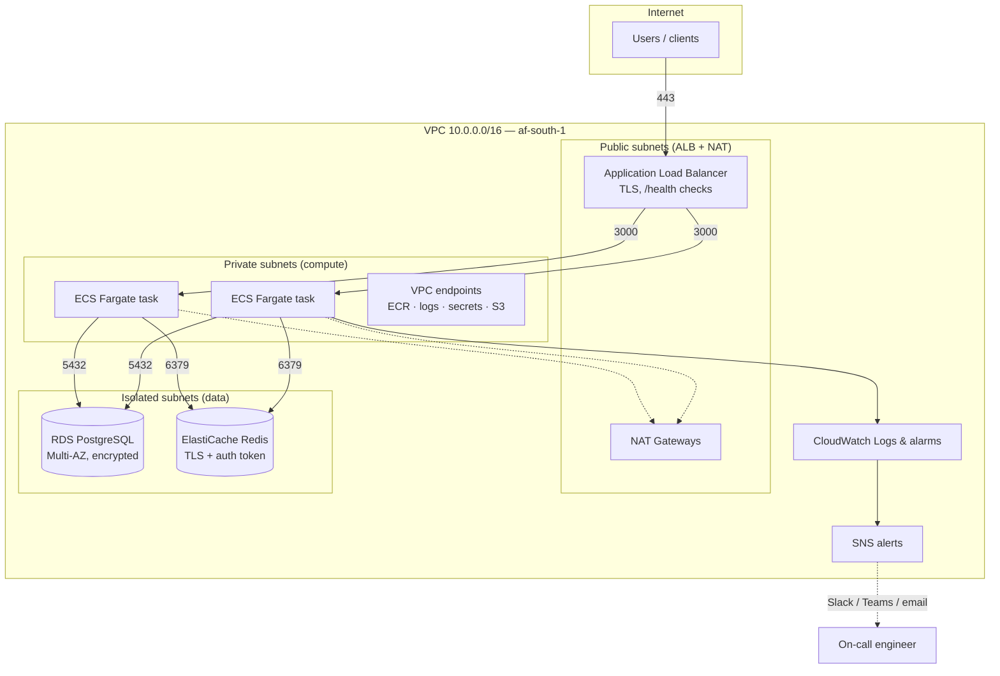

# Cloud Infrastructure & CI/CD Pipeline

A production-shaped, fully automated deployment platform: a containerised Node.js API, its
entire AWS footprint defined in Terraform, and a GitHub Actions pipeline that ships merges to
`main` with zero downtime and a one-click rollback.

Built as Project #4 of a South African enterprise migration programme. The target audience is a
bank or telco replacing hand-built on-premise servers with reproducible, auditable cloud
infrastructure — so the design centres on network isolation, secret hygiene, deploy safety and
operational visibility rather than on the demo endpoint.

```
Pull request ──► tests + lint + SAST + terraform validate + image build/scan
                          │
Merge to main ────────────┘
        │
        ├─► build immutable image  ──►  push to ECR (tag = git SHA)
        ├─► export live task definition, render new image
        ├─► ECS rolling update (100% min healthy, 200% max)
        ├─► wait for service stability
        └─► smoke test /health + /ready  ──►  fail ⇒ automatic rollback
```

---

## Architecture



Terraform state lives in an encrypted S3 bucket with DynamoDB locking. GitHub Actions
authenticates to AWS with short-lived OIDC tokens — there are no long-lived AWS keys anywhere in
this repository.

---

## Repository layout

```
.
├── src/                        API: config, logging, metrics, routes
│   ├── app.js                  Express app factory (dependency injection)
│   ├── server.js               boot + SIGTERM graceful drain
│   ├── config.js               fail-fast environment validation
│   ├── metrics.js              Prometheus registry
│   ├── store/postgres.js       pooled RDS access
│   └── cache.js                ElastiCache client + cache-aside helper
├── test/                       33 tests on node:test (no external services needed)
├── terraform/                  VPC, ECS, ALB, RDS, ElastiCache, IAM, alarms
│   ├── envs/prod.tfvars        production inputs
│   └── backend.hcl.example     remote state template
├── .github/workflows/
│   ├── ci.yml                  PR gate: test, lint, audit, Trivy, terraform validate
│   ├── deploy.yml              build → push → rolling update → smoke test → rollback
│   ├── rollback.yml            manual one-click rollback
│   └── terraform.yml           plan on PR, apply behind environment approval
├── scripts/                    bootstrap, export task def, smoke test, rollback
├── deploy/task-definition.json base revision (regenerated from the live service)
├── docs/                       SRS, SDD, test plan, bug reports, runbook, logs
├── Dockerfile                  multi-stage, non-root, SIGTERM-aware
└── compose.yaml                local API + Postgres + Redis
```

---

## Quick start (local)

```bash
npm ci
npm test                # 33 tests, no database required
npm run lint

# full stack
docker compose up --build
curl localhost:3000/health
curl localhost:3000/ready
```

The API exposes:

| Endpoint | Purpose |
| --- | --- |
| `GET /health` | Liveness. Dependency free — this is the ALB target group check |
| `GET /ready` | Readiness. Checks Postgres + Redis; returns 503 while draining |
| `GET /metrics` | Prometheus exposition for CloudWatch/Grafana scraping |
| `GET /api/v1/items` | List items (`?limit=` capped at 100) |
| `POST /api/v1/items` | Create an item |
| `GET /api/v1/items/:id` | Fetch one item |

---

## Deploying

### 1. Prerequisites

- AWS account with permissions to create VPC/ECS/RDS/IAM resources
- `terraform >= 1.7`, `awscli v2`, `jq`, Docker (for local builds)
- A GitHub repository containing this code

### 2. Bootstrap remote state

```bash
AWS_PROFILE=your-profile ./scripts/bootstrap-aws.sh
```

Creates the versioned, encrypted S3 bucket, the DynamoDB lock table and
`terraform/backend.hcl`.

### 3. Apply the infrastructure

```bash
cd terraform
terraform init -backend-config=backend.hcl
terraform plan  -var-file=envs/prod.tfvars
terraform apply -var-file=envs/prod.tfvars
```

`app_image` starts as a placeholder on purpose: the first pipeline run registers the real task
revision. Terraform ignores subsequent `task_definition` changes so CI owns the running revision
while Terraform owns the infrastructure shape.

### 4. Configure the repository

Settings → Variables (not secrets — none of these are credentials):

| Variable | Example |
| --- | --- |
| `AWS_DEPLOY_ROLE_ARN` | `arn:aws:iam::123456789012:role/sa-enterprise-prod-github-deploy` |
| `ECR_REPOSITORY` | `sa-enterprise-prod/api` |
| `ECS_CLUSTER` | `sa-enterprise-prod-cluster` |
| `ECS_SERVICE` | `sa-enterprise-prod-api` |
| `ALB_URL` | `http://sa-enterprise-prod-alb-123456.af-south-1.elb.amazonaws.com` |
| `AWS_REGION` | `af-south-1` |
| `TF_STATE_BUCKET` | state bucket from step 2 |
| `TF_STATE_LOCK_TABLE` | lock table from step 2 |

Then create a `production` environment (Settings → Environments) and add required reviewers if
you want a human gate before every deploy.

### 5. Ship something

```bash
git push origin main      # tests -> image -> rolling update -> smoke test
```

Failures after the update trigger `scripts/rollback.sh` with the exact task definition ARN that
was running beforehand.

Manual rollback: **Actions → Rollback → Run workflow** (leave the revision empty to go to the
previous active revision).

---

## How zero downtime is guaranteed

| Setting | Value | Effect |
| --- | --- | --- |
| `deployment_minimum_healthy_percent` | 100 | New tasks must pass health checks before old ones leave |
| `deployment_maximum_percent` | 200 | Old and new revisions run side by side |
| `deployment_circuit_breaker.rollback` | true | ECS reverts a revision that never stabilises |
| Target group `deregistration_delay` | 20s | In-flight requests finish before the target is removed |
| Container `stopTimeout` | 30s | Matches `GRACEFUL_SHUTDOWN_MS` (20s) + margin |
| `/ready` returns 503 on SIGTERM | — | ALB stops routing before the process exits |
| ALB health check | `GET /health`, 15s interval | Independent of database availability |
| Desired count | ≥ 2 across 3 AZs | No single task or AZ is a single point of failure |

---

## Security posture

| Control | Implementation |
| --- | --- |
| No credentials in source | `random_password` → Secrets Manager → ECS `secrets` injection |
| No long-lived AWS keys | GitHub OIDC federation, scoped to this repo and branch |
| Data tier unreachable from the internet | Isolated subnets with no default route, `publicly_accessible = false` |
| Tier-to-tier least privilege | Security group references, no CIDR-based database access |
| Encryption in transit | HTTPS listener, `sslmode=require`, `rediss://` with auth token |
| Encryption at rest | RDS storage encryption, ElastiCache at-rest encryption, encrypted SNS, encrypted state bucket |
| Supply chain | Immutable ECR tags, Trivy scans on filesystem and image, `npm audit` gate |
| Container hardening | Non-root `node` user, no build toolchain in the runtime layer |

---

## Observability

- **Logs:** structured JSON on stdout → `/ecs/sa-enterprise-prod/api` in CloudWatch, queryable
  with Logs Insights (`fields @timestamp, level, requestId, status`).
- **Metrics:** `/metrics` exposes request rate, latency histogram and `app_ready`.
- **Alarms:** ALB 5XX ratio > 5% (5 min), unhealthy targets, ECS CPU > 85%, ECS memory > 85%,
  RDS CPU > 80%, free storage < 10 GiB. All wired to an SNS topic with OK actions.
- **Dashboard:** `${project}-${env}-overview` in CloudWatch.

Slack/Teams delivery is a one-time console step: attach the `alerts_topic_arn` output to an AWS
Chatbot Slack/Teams channel configuration.

---

## Documentation

| Phase | Deliverable | Document |
| --- | --- | --- |
| Requirements | SRS | [`docs/SRS.md`](docs/SRS.md) |
| Design | SDD | [`docs/SDD.md`](docs/SDD.md) |
| Implementation | Source code | this repository |
| Testing | Test plan & bug reports | [`docs/TEST_PLAN.md`](docs/TEST_PLAN.md), [`docs/BUG_REPORTS.md`](docs/BUG_REPORTS.md) |
| Deployment / maintenance | Release notes & log | [`docs/RELEASE_NOTES.md`](docs/RELEASE_NOTES.md), [`docs/MAINTENANCE_LOG.md`](docs/MAINTENANCE_LOG.md) |
| Operations | Runbook | [`docs/RUNBOOK.md`](docs/RUNBOOK.md) |

---

## Cost note

Baseline production cost is dominated by NAT gateways, RDS Multi-AZ and ElastiCache. For a demo
account set `single_nat_gateway = true`, `db_multi_az = false`, `desired_count = 2`, and
`availability_zone_count = 2`. Expect roughly R3k–R6k/month at low traffic in `af-south-1`;
see `docs/RELEASE_NOTES.md` for the optimisation backlog.

---

## License

[MIT](LICENSE) © 2026 Sipho Makubalo
