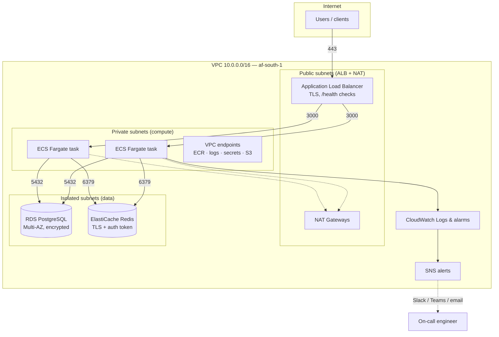

# Cloud Infrastructure & CI/CD Pipeline

A production-shaped deployment platform: a containerised Node.js API, its entire AWS footprint in
Terraform, and a GitHub Actions pipeline that ships merges to `main` with zero downtime and a
one-click rollback.

**Live ops console:** https://sklevel8-cloud-infra.netlify.app
**Stack:** Node.js · Express · PostgreSQL · Redis · Terraform · AWS ECS Fargate · ALB · GitHub Actions

---

## Why this exists

Most portfolio APIs stop at the point where `npm start` works. That is the easy half. The hard half —
the part a bank or telco actually buys — is what happens when the service must be deployed
repeatedly, audited, and recovered at 2 a.m.:

- Where does the infrastructure definition live, and can it be rebuilt from nothing?
- How does a deploy avoid a single second of dropped traffic?
- What stops a bad image from reaching production, and how fast can it be undone?
- Where are the credentials, and how long do they live?
- When it breaks, what does the on-call engineer look at?

This project was built as the answer to those questions: a deliberately boring API wrapped in a
platform that is reproducible, auditable and safe to change. The design centres on network isolation,
secret hygiene, deploy safety and observability rather than on the demo endpoint.

## How it works

```
Pull request ──► tests + lint + SAST + terraform validate + image build/scan
                          │
Merge to main ────────────┘
        │
        ├─ build immutable image → push to ECR (tag = git SHA)
        ├─ export live task definition, render new image
        ├─ ECS rolling update (100% min healthy, 200% max)
        ├─ wait for service stability
        └─ smoke test /health + /ready → fail ⇒ automatic rollback
```

### Architecture



Three network tiers, because the blast radius of a compromised task should not include the database:
ALB and NAT in public subnets, Fargate tasks in private subnets with no inbound path except the load
balancer, and RDS/ElastiCache in isolated subnets reachable only from the compute tier.

Terraform state lives in a versioned, encrypted S3 bucket with DynamoDB locking. GitHub Actions
authenticates to AWS with short-lived **OIDC** tokens, so there are no long-lived AWS keys anywhere in
the repository.

### How zero downtime is guaranteed

1. **Rolling update with headroom.** ECS is configured for 100% minimum healthy and 200% maximum, so
   new tasks must pass health checks before old ones are drained.
2. **Two health endpoints with different jobs.** `/health` is dependency-free and is what the ALB
   target group polls; `/ready` checks Postgres and Redis and returns `503` while the task is
   draining.
3. **`SIGTERM` handling.** `server.js` stops accepting connections, finishes in-flight requests, then
   exits — within the ALB deregistration delay.
4. **Smoke test before the deploy is "done".** The pipeline polls `/health` and `/ready` against the
   new revision; a failure triggers an automatic rollback to the previous task definition.
5. **Immutable images.** Tags are git SHAs, never `latest`, so a rollback is a known artefact, not a
   rebuild.

### Endpoints

| Endpoint | Purpose |
| --- | --- |
| `GET /health` | Liveness, dependency-free (ALB target group check) |
| `GET /ready` | Readiness: Postgres + Redis; `503` while draining |
| `GET /metrics` | Prometheus exposition |
| `GET /api/v1/items` | List items (`?limit=` capped at 100) |
| `POST /api/v1/items` | Create an item |
| `GET /api/v1/items/:id` | Fetch one item |

## Features

- Fully declarative AWS footprint: VPC, subnets, NAT, ECS Fargate, ALB, RDS Multi-AZ, ElastiCache,
  IAM, CloudWatch alarms, SNS
- Remote Terraform state with S3 versioning, encryption and DynamoDB locking
- OIDC-based GitHub Actions authentication — no static AWS credentials
- PR gate: unit tests, ESLint, dependency audit, Trivy image scan, `terraform validate`/`plan`
- Immutable ECR images tagged by commit SHA
- Rolling deploys with health-gated smoke tests and automatic rollback
- Manual `rollback.yml` workflow for one-click recovery
- Multi-stage, non-root, `SIGTERM`-aware Dockerfile
- 33 tests on `node:test`, no external services required
- Prometheus metrics and a readiness endpoint distinct from liveness

## Run it locally

```bash
npm ci
npm test                 # 33 tests, no database required
npm run lint
npm run test:coverage

docker compose up --build
curl localhost:3000/health
curl localhost:3000/ready
```

## Deploying to AWS

Prerequisites: an AWS account with permissions to create VPC/ECS/RDS/IAM resources,
`terraform >= 1.7`, `awscli v2`, `jq`, Docker.

```bash
# 1. Remote state bucket, lock table and backend.hcl
AWS_PROFILE=your-profile ./scripts/bootstrap-aws.sh

# 2. Infrastructure
cd terraform
terraform init -backend-config=backend.hcl
terraform plan  -var-file=envs/prod.tfvars
terraform apply -var-file=envs/prod.tfvars
```

`app_image` starts as a placeholder on purpose: the first pipeline run registers the real task
revision. Terraform then ignores subsequent task-definition changes, so Terraform owns the shape of
the infrastructure while CI owns what is running.

The full walkthrough — repository variables, environment approval, first deploy, rollback drill —
is in `docs/`.

## The deployed ops console

Netlify publishes `web/` — a static console that visualises the parts of this system a static host
can honestly show: service health, latency percentiles, SLO burn, the request topology, the pipeline
stages, recent deployments and the API surface. It is driven by sample data shaped like the real
CloudWatch and pipeline outputs, and is labelled as such.

The infrastructure itself is not deployed for the public demo — an AWS account with ECS, RDS and
NAT gateways is not something you leave standing for a portfolio link.

## Project layout

```
src/                    API: config, logging, metrics, routes, store, cache
test/                   33 tests on node:test
terraform/              VPC, ECS, ALB, RDS, ElastiCache, IAM, alarms
.github/workflows/      ci.yml, deploy.yml, rollback.yml, terraform.yml
scripts/                bootstrap, task-def export, smoke test, rollback
deploy/                 base task definition revision
docs/                   SRS, SDD, test plan, bug reports, runbook
web/                    deployed static ops console
Dockerfile              multi-stage, non-root, SIGTERM-aware
compose.yaml            local API + Postgres + Redis
```

## Cost note

The Terraform is real: applying it creates billable resources, and the NAT gateways plus RDS
Multi-AZ are the expensive parts. Tear down with `terraform destroy` if you only want to read the
code.

## Licence

MIT
