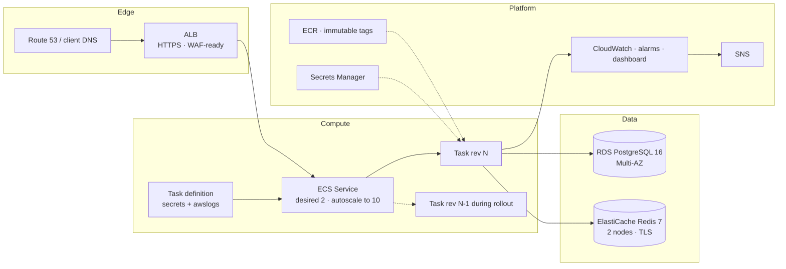
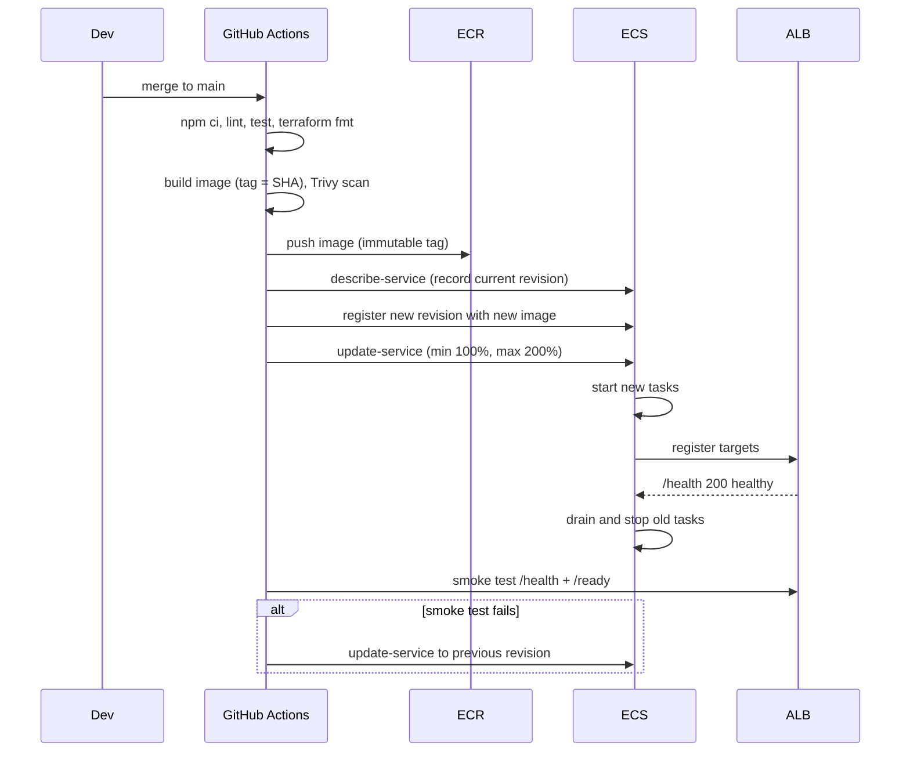

# System Design Document (SDD)

**Project:** Cloud Infrastructure & CI/CD Pipeline (Project #4)
**Role:** System Architect
**Status:** Approved design for v1.0.0

---

## 1. Design goals

1. **Reproducible** — the entire environment is code; a destroyed stack rebuilds identically.
2. **Safe to release** — every deploy either succeeds with zero dropped requests or reverses itself.
3. **Isolated by default** — only the load balancer is reachable from the internet.
4. **Attributable** — every production change traces to a commit, a workflow run and a role session.
5. **Observable** — a new engineer can find out what broke without SSH.

---

## 2. Component model



| Component | Choice | Rationale |
| --- | --- | --- |
| Compute | ECS on Fargate | No host patching, per-task IAM, native rolling deployments, cheaper than EKS to operate |
| Registry | ECR with immutable tags | A Git SHA tag can never be re-pointed; rollback targets stay valid |
| Database | RDS PostgreSQL 16, Multi-AZ | Managed failover, PITR, encrypted storage, private endpoint |
| Cache | ElastiCache Redis 7, 2 nodes | Session/read cache with automatic failover and TLS |
| Edge | ALB, cross-zone, access logs | Health-check-aware traffic shifting is the zero-downtime mechanism |
| Secrets | Secrets Manager | Rotation path, IAM-scoped reads, no secret material in task definitions |
| CI/CD | GitHub Actions + OIDC | No static AWS keys; environment protection gives an approval gate |
| Observability | CloudWatch + Prometheus endpoint | Native alarms for infrastructure, portable metrics for application detail |

---

## 3. Network topology

```
VPC 10.0.0.0/16  (af-south-1, 3 AZs)

  public   10.0.0.0/24 .. 10.0.2.0/24     ALB, NAT gateways, IGW
  private  10.0.10.0/24 .. 10.0.12.0/24   ECS Fargate tasks, VPC endpoints
  isolated 10.0.20.0/24 .. 10.0.22.0/24   RDS, ElastiCache (no default route)
```

| Path | Allowed by |
| --- | --- |
| Internet → ALB:443 | ALB security group, `0.0.0.0/0` |
| ALB → tasks:3000 | App security group ingress referencing the ALB group |
| Tasks → RDS:5432 / Redis:6379 | App egress + data ingress, security group references only |
| Tasks → AWS APIs:443 | Interface endpoints (ECR, logs, secrets) and S3 gateway endpoint |
| Tasks → internet:443 | NAT gateway, for third-party APIs only |
| Data tier → anything | Nothing. No route, no egress rules |

The isolated tier intentionally has **no** default route. Even a compromised container with valid
credentials cannot exfiltrate over a path that does not exist, and the database has no public
endpoint to attack.

---

## 4. Deployment pipeline



**Stage gates**

| Stage | Tool | Blocks |
| --- | --- | --- |
| Unit tests | `node --test`, c8 coverage | Any failing test |
| Lint | ESLint 10 flat config | Style/regression issues |
| Dependency audit | `audit-ci --high` | Known high/critical advisories |
| SAST/secret scan | Trivy fs (`vuln,secret,config`) | Committed secrets, critical misconfig |
| Image scan | Trivy image | Vulnerable base layer |
| IaC | `terraform fmt -check`, `validate` | Unformatted or invalid HCL |
| Runtime | Container smoke test against real Postgres/Redis | Broken boot, broken migration, broken probes |
| Production | `wait-for-service-stability` + ALB smoke test | Anything unhealthy after rollout |

---

## 5. Failure handling

| Failure | Detection | Response |
| --- | --- | --- |
| Bad image / crash loop | ECS circuit breaker, ALB unhealthy targets | New revision rolled back automatically |
| Task cannot read secret | `/ready` 503, ECS task stopped reason | Deployment fails; previous revision keeps serving |
| ALB 5XX spike after release | CloudWatch alarm (5% / 5 min) | SNS alert; rollback workflow |
| Database failover | RDS Multi-AZ, `/ready` transient 503 | ALB keeps existing connections on healthy tasks; `/health` stays 200 so tasks are not killed |
| Task killed by deploy | SIGTERM | App flips `/ready` to 503, drains for up to 20s, exits 0 inside the 30s `stopTimeout` |
| Availability zone loss | 3 AZs, cross-zone LB, Multi-AZ RDS | Capacity continues on remaining AZs |
| State corruption / drift | `terraform plan` in PR | Review before apply |
| Region-scale event | Nightly snapshots, Terraform rebuild | Restore RDS from snapshot, re-apply, re-deploy last good SHA |

---

## 6. Data and state

| Data | Store | Protection |
| --- | --- | --- |
| Application data | RDS PostgreSQL | Encrypted gp3, 30-day PITR, Multi-AZ |
| Cache / sessions | ElastiCache | TLS, auth token, at-rest encryption, 7-day snapshots |
| Terraform state | S3 | Versioned, AES256, public access blocked, DynamoDB lock |
| Container images | ECR | Immutable tags, scan on push, 50-image retention |
| Logs | CloudWatch | 30-day retention, JSON fields for Insights |
| Secrets | Secrets Manager | IAM-scoped, 30-day recovery window in prod |

---

## 7. Observability design

- **Structured logging** — one JSON object per line with `timestamp`, `level`, `requestId`, route,
  status and duration. `requestId` is propagated from `x-request-id` for cross-service tracing.
- **Metric layers** — infrastructure (ECS/ALB/RDS via Container Insights), application
  (`/metrics`: `http_request_duration_seconds`, `http_requests_total`, `app_ready`), and business
  (item creation count, if needed later).
- **Alarm philosophy** — alert on symptoms users feel (5XX ratio, unhealthy targets) and on
  capacity ceilings (CPU, memory, storage). Every alarm has an OK action so recovery is visible.
- **Dashboard** — requests vs 5XX, target latency percentiles, ECS CPU/memory, RDS CPU/connections.

---

## 8. Deviations from the original design review

| Original | Implemented | Why |
| --- | --- | --- |
| Static `AWS_ACCESS_KEY_ID` / `AWS_SECRET_ACCESS_KEY` secrets | GitHub OIDC role assumption | Removes long-lived credentials; SRS SR-02 tightened |
| `task-definition.json` used verbatim | Exported from the live service before each render | Prevents drift between Terraform and CI |
| Health check on `/` | `/health` (dependency free) + `/ready` (dependency aware) | Database blips must not kill healthy tasks |
| CloudWatch alarms only for 5XX and CPU | Added unhealthy targets, memory, RDS CPU and storage | Capacity alarms catch failures before users do |
| Autoscaling deferred to v1.1.0 | Delivered in v1.0.0 (CPU + request count) | `desired_count` static was the largest availability risk |
| VPC endpoints as a cost optimisation idea | Delivered | Also keeps ECR/Secrets traffic off the NAT path |
| Unspecified log group | `/ecs/<project>-<env>/api` with 30-day retention | Consistent naming with alarms and runbook |

---

## 9. Capacity and cost model

| Item | Baseline | Notes |
| --- | --- | --- |
| ECS Fargate | 2 × (0.5 vCPU, 1 GiB) | Autoscales to 10 tasks; billing is per second |
| RDS | `db.t4g.medium` Multi-AZ, 50 GiB gp3 | Autogrows to 200 GiB |
| ElastiCache | 2 × `cache.t4g.small` | Automatic failover |
| NAT | 3 gateways | Largest fixed cost; `single_nat_gateway = true` for demos |
| ALB | 1 | ~$18/month + LCU |
| Misc | ECR, CloudWatch, Secrets Manager, SNS | Single-digit dollars at low volume |

Teardown for a demo account: set `db_multi_az = false`, `single_nat_gateway = true`,
`availability_zone_count = 2`, `min_capacity = 1`, then `terraform destroy`.
